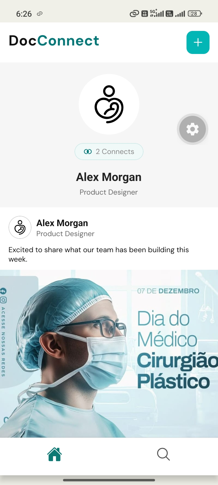
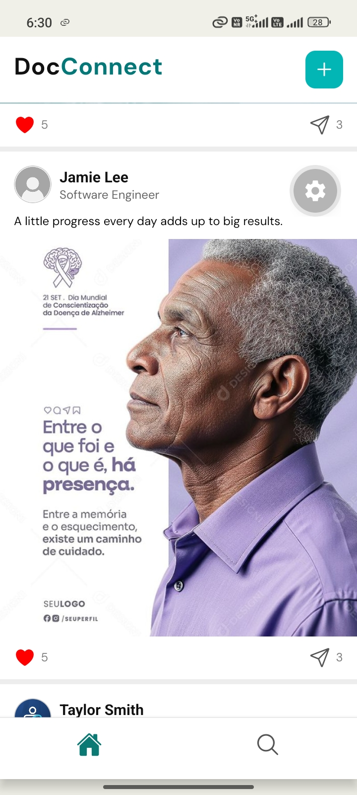
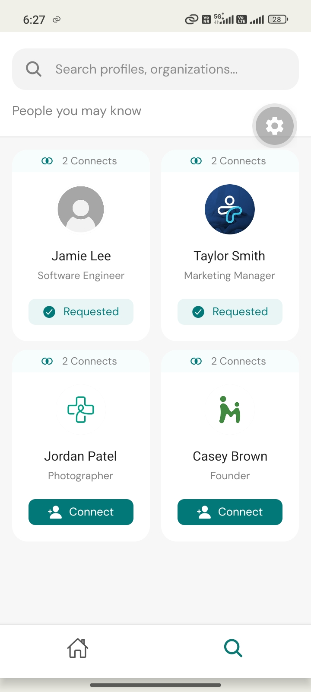

# TheBrandopedia — React Native Full-Stack Assignment

A mobile application built using React Native and Expo, with a Node.js, Express, and MongoDB backend.

## Features

- **Home:** Displays the current user's profile and a feed of five posts.
- **Discover:** Displays user profiles with Connect buttons.
- **Connection Requests:** Updates the button to Requested after a successful request.
- **Persistent State:** Preserves requested status after restarting the app using MongoDB data.
- **Backend Integration:** Fetches user profiles and posts and stores connection requests in MongoDB.
- **Dynamic Current User:** Retrieves the current user's ID from the backend instead of relying on a hardcoded MongoDB ID.

## Tech Stack

- React Native
- Expo
- Node.js
- Express.js
- MongoDB
- Mongoose

## Project Structure

```text
Brandopedia-Assignment/
├── Brandopedia/          # Mobile application
├── Brandopedia_server/   # Backend API and seed script
├── screenshots/
│   ├── Home1.jpeg
│   ├── Home2.jpeg
│   └── Discover.jpeg
├── .gitignore
└── README.md
```

## Prerequisites

- Node.js and npm
- MongoDB running locally or a MongoDB Atlas database
- Expo Go or an Android emulator

## 1. Backend Setup

Open a terminal in the backend directory:

```bash
cd Brandopedia_server
npm install
```

### Configure Environment Variables

Create a `.env` file inside `Brandopedia_server`:

```env
PORT=5000
MONGODB_URI=mongodb://127.0.0.1:27017/brandopedia
```

Use your own MongoDB connection string if you are using MongoDB Atlas. Never commit your `.env` file.

### Seed the Database

Run the seed script to populate the database with sample users and posts:

```bash
npm run seed
```

The seed script resets the assignment's sample data and inserts the demo users and posts. Run it again only when you want to reset the sample data.

### Start the Backend

```bash
npm start
```

The backend runs on port `5000` when configured as shown above.

## 2. Mobile App Setup

Open another terminal in the mobile application directory:

```bash
cd Brandopedia
npm install
```

### Configure the API URL

Create a `.env` file inside `Brandopedia`:

```env
EXPO_PUBLIC_API_URL=http://localhost:5000
```

Configure the URL according to your environment:

| Environment | API URL |
|---|---|
| iOS simulator or web | `http://localhost:5000` |
| Android emulator | `http://10.0.2.2:5000` |
| Physical device using Expo Go | `http://YOUR_COMPUTER_IP:5000` |

For a physical device, replace `YOUR_COMPUTER_IP` with your computer's local network IP address. Ensure both devices are on the same Wi-Fi network and the backend is accessible.

After changing the environment variables, restart Expo with a clean cache:

```bash
npx expo start --clear
```

Scan the QR code using Expo Go or open the app in your configured emulator.

## 3. API Endpoints

| Method | Endpoint | Description |
|---|---|---|
| GET | `/users` | Retrieves user profiles and connection-request status |
| GET | `/posts` | Retrieves the post feed |
| POST | `/connect` | Creates a connection request |

The backend selects a default current user when `currentUserId` is omitted from the users request. The app uses the returned current user's ID when creating connection requests.

## 4. Running the Complete Project

1. Start MongoDB.
2. Run `npm run seed` in `Brandopedia_server` to populate or reset the sample data.
3. Start the backend using `npm start`.
4. Start the mobile app using `npx expo start --clear` inside `Brandopedia`.
5. Open the app on a device or emulator.

## Notes

- No login or authentication flow is required for this assignment.
- MongoDB must be accessible to the backend.
- The mobile app and backend are intended to run locally.
- Do not commit environment variables, credentials, or dependency folders.

## Screenshots

### Home Screen




### Discover Screen


